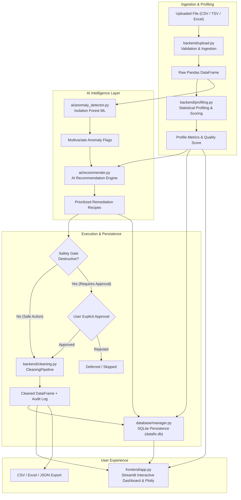

# ⚡ DataFix – Autonomous Data Quality Engine

> **Autonomous tabular data inspection, machine-learning anomaly detection, AI-guided remediation recipes, and reproducible transformation pipelines.**

---

## 📖 Project Overview

**DataFix** is an autonomous data quality engine designed to detect, profile, analyze, and remediate data quality issues in tabular datasets. Developed as a modern analytics solution, DataFix replaces fragile manual data wrangling scripts with an end-to-end, machine-learning-powered quality pipeline.

From initial file ingestion through multivariate anomaly detection and automated remediation planning, DataFix ensures your datasets are clean, reliable, and production-ready—while guaranteeing data safety with immutable transformations and explicit user approval gates for destructive operations.

---

## 🚀 Key Features

### 1. Robust Dataset Ingestion & Format Validation
- Seamless support for **CSV**, **TSV**, and modern **Excel** (`.xlsx`, `.xls`, `.xlsm`, `.xlsb`) workbooks.
- Multi-encoding fallback handling (`utf-8`, `utf-8-sig`, `latin-1`, `cp1252`).
- Safe in-memory buffer handling for Streamlit `UploadedFile` objects.
- Comprehensive guards for empty files (0 bytes), header-only tables, and corrupted rows.

### 2. Automated Statistical Profiling
- **Structural Metrics**: Row counts, column counts, total matrix cells, and memory footprint in MB.
- **Schema & Dtype Classification**: Categorizes columns into numerical, categorical, datetime, and boolean with cardinality detection (`constant`, `binary`, `unique_identifier`, `low`, `medium`, `high`).
- **Missingness & Duplication**: Per-column null counts/percentages, global missing cells, and exact duplicate row identification.
- **Descriptive Statistics**: Mean, median, standard deviation, min, max, quartiles (Q1, Q3), IQR, skewness, kurtosis, zero counts, and negative counts.
- **Categorical Analysis**: Dominant modes, frequency distribution, and top $N$ value distributions.

### 3. Quantitative Data Quality Scoring
- Standardized **0–100 Data Quality Health Score** calculated across 4 weighted dimensions:
  - **Completeness (40%)**: Proportion of populated, non-null cells.
  - **Uniqueness (30%)**: Proportion of unique, non-duplicate records.
  - **Validity & Outlier Health (15%)**: Evaluates concentration of values outside Tukey's IQR boundaries.
  - **Structural Health (15%)**: Penalizes completely empty or zero-variance (constant) columns.
- Quality rating grades: **Excellent** ($\ge 90$), **Good** ($\ge 75$), **Fair** ($\ge 60$), and **Poor** ($< 60$).
- Actionable health alerts categorized into `critical`, `warning`, and `info`.

### 4. Machine-Learning Anomaly Detection (Scikit-Learn)
- Unsupervised multivariate anomaly detection using **Isolation Forest**.
- Detects subtle multidimensional outliers across correlated numerical columns that univariate filters miss.
- Automatic feature scaling (`StandardScaler`) and defensive median imputation for model training.
- Continuous decision scoring, anomaly percentage calculation, and top-contributing feature attribution.

### 5. Autonomous AI Remediation Recommender
- Diagnostic rule engine that maps profiling alerts and anomaly signals to concrete cleaning recipes.
- Every recommendation provides:
  - **Problem Identified**: Exact diagnosis with empirical metrics.
  - **Recommended Solution**: Specific transformation method.
  - **Statistical Rationale**: Domain reasoning (e.g., why median was chosen over mean for skewed distributions).
  - **Confidence Score**: 0.0 to 1.0 confidence rating.
- **Safety Gate**: Clearly partitions actions into **Safe (Non-Destructive)** and **Destructive**. Destructive operations (dropping rows or columns) can **never** execute automatically and require explicit confirmation.

### 6. Deterministic Data Cleaning Pipeline
- Non-destructive execution: **the original raw dataset is never mutated**.
- **Imputation**: `mean`, `median`, `mode`, `constant`, `forward_fill`, `backward_fill`, `drop_rows`, `drop_column`.
- **Deduplication**: `drop_first`, `drop_last`, `drop_all` across all columns or specific subsets.
- **Outlier Remediation**: Tukey's IQR or Z-score Winsorization (`clip`), row removal (`drop`), or conversion to `NaN` (`set_null`).
- **Text Normalization**: Whitespace stripping, casing consistency (`lower`, `upper`, `title`), punctuation sanitization, and whitespace-to-NaN coercion.
- **Type Casting**: Safe coercion for numeric strings with currency/commas (`$50,000`), nullable integers (`Int64`), booleans (`yes`/`no`/`true`/`false`), and datetimes.
- **Audit Logging**: Every operation records step number, operation name, columns affected, parameter values, row counts before/after, and UTC timestamps.

### 7. SQLite Persistence Layer
- Zero external ORM dependencies; uses Python's built-in `sqlite3`.
- Strict relational foreign key enforcement (`PRAGMA foreign_keys = ON;`) with cascading deletes (`ON DELETE CASCADE`).
- Stores analysis sessions, profiling reports, AI recommendations, cleaning audit histories, and before-vs-after quality comparisons.
- Recursive JSON sanitization for NumPy scalars (`int64`, `float64`), NaNs, and infinite values.

### 8. Interactive Streamlit Dashboard
- Multi-page responsive analytics interface built with Streamlit and Plotly.
- Dynamic gauge meters, missingness distribution bars, schema donut charts, outlier boxplots, and 2D anomaly scatter plots.
- One-click demo dataset loader for instant evaluation.
- One-click *"Apply All Safe Recommendations"* button.
- Before-and-after quality improvement analytics with score delta banners.
- Direct export to **CSV**, **Excel (.xlsx)**, and **Audit Trail (JSON)**.

---

## 🏗️ Architecture & Data Flow



---

## 💻 Technology Stack

| Layer | Technology | Purpose |
| :--- | :--- | :--- |
| **Language** | Python 3.13 | Core runtime environment |
| **Frontend & UI** | Streamlit | Responsive web dashboard and state management |
| **Visualization** | Plotly | Interactive charts (gauge, boxplot, bar, scatter) |
| **Data Processing** | Pandas, NumPy | High-performance tabular data manipulation |
| **Machine Learning** | Scikit-learn (`IsolationForest`, `StandardScaler`) | Multivariate anomaly detection |
| **Excel Ingestion** | OpenPyXL | Reading and writing modern Excel spreadsheets |
| **Persistence** | SQLite (`sqlite3`) | Relational audit trail and session storage |
| **Testing** | Pytest | Automated test runner and assertion suite |

---

## 📁 Project Structure

```
DataFix-Autonomous-Data-Quality-Engine-1/
├── ai/                                # AI & Machine Learning Intelligence Layer
│   ├── __init__.py                    # Public API for AI module
│   ├── anomaly_detector.py            # Scikit-learn Isolation Forest anomaly detection
│   └── recommender.py                 # Rule-based recommendation engine & safety bridges
├── backend/                           # Core Data Engine & Transformation Primitives
│   ├── __init__.py                    # Public API for backend modules
│   ├── upload.py                      # Multi-format ingestion, empty checks, and validation
│   ├── profiling.py                   # Automated profiling, summary stats, and quality scoring
│   └── cleaning.py                    # Deterministic transformations, pipeline, and audit logging
├── database/                          # SQLite Persistence & Audit Storage
│   ├── __init__.py                    # Public API for database manager
│   ├── schema.py                      # SQLite DDL statements, foreign keys, and indices
│   └── manager.py                     # DatabaseManager with context management & CRUD
├── frontend/                          # Streamlit Interactive Dashboard
│   ├── __init__.py                    # Frontend package init
│   ├── app.py                         # Main Streamlit web application & page router
│   ├── styles.py                      # Custom CSS styling, badges, and card designs
│   └── visualizations.py              # Reusable Plotly chart components
├── tests/                             # Comprehensive Automated Unit Test Suite
│   ├── test_upload.py                 # Ingestion, validation, and encoding tests (17 tests)
│   ├── test_profiling.py              # Profiling, statistical, and edge case tests (14 tests)
│   ├── test_cleaning.py               # Cleaning transformations & immutability tests (32 tests)
│   ├── test_ai.py                     # Anomaly detection & recommendation tests (15 tests)
│   └── test_database.py               # SQLite schema, CRUD, and cascade tests (10 tests)
├── pytest.ini                         # Pytest configuration (pythonpath = .)
├── requirements.txt                   # Production dependencies
└── README.md                          # Comprehensive project documentation
```

---

## ⚙️ Installation & Setup

### Prerequisites
- Python 3.10+ (tested with Python 3.13)
- `git`

### 1. Clone the Repository
```bash
git clone https://github.com/Dhanushree07/DataFix-Autonomous-Data-Quality-Engine.git
cd DataFix-Autonomous-Data-Quality-Engine-1
```

### 2. Create and Activate a Virtual Environment
```powershell
# Windows (PowerShell)
python -m venv .venv
.\.venv\Scripts\Activate.ps1
```

### 3. Install Dependencies
```bash
pip install -r requirements.txt
```

---

## 🏃 Execution Instructions

### Run the Streamlit Dashboard
Launch the interactive web application using Streamlit:
```powershell
streamlit run frontend/app.py
```
Or run directly via the virtual environment's Python binary:
```powershell
.\.venv\Scripts\python.exe -m streamlit run frontend/app.py
```

Once launched, open your web browser to:
```
http://localhost:8501
```

> **Tip:** You can click the **"🚀 Load Sample Hackathon Dataset"** button on the Home tab to immediately explore anomalies, profiling metrics, and AI recommendations without needing to upload a local file.

---

## 🧪 Running the Test Suite

DataFix features **88 comprehensive unit tests** across all 4 operational phases:

```powershell
.\.venv\Scripts\python.exe -m pytest -v
```

### Test Suite Breakdown:
- **`tests/test_upload.py`** (17 tests): Ingestion, format validation, empty file guards, encoding fallbacks, multi-sheet Excel.
- **`tests/test_profiling.py`** (14 tests): Dimension calculation, column typing, missing values, duplicates, descriptive statistics, Tukey's IQR outliers, quality scores.
- **`tests/test_cleaning.py`** (32 tests): Immutability verification, missing value strategies, deduplication, outlier clipping, text sanitization, type coercion, pipeline execution.
- **`tests/test_ai.py`** (15 tests): Isolation Forest detection, recommendation generation, confidence rating, safety execution enforcement.
- **`tests/test_database.py`** (10 tests): In-memory and file-based SQLite, foreign key cascading, JSON serialization of NumPy types, confirmation guards on deletion.

---

## 🛡️ Safety & Data Integrity Principles

1. **Non-Destructive Guarantee**: Raw input DataFrames are treated as strictly immutable; transformations always operate on defensive copies.
2. **Explicit Approval Gate**: Operations that delete rows (deduplication, row filtering) or drop columns (`drop_column`) require explicit user confirmation (`approved=True`) before execution.
3. **Traceable Audit Logging**: Every modification records its exact before/after metrics and parameters in an exportable audit history.
4. **No Synthetic AI Fabrication**: Recommendations are grounded entirely in empirical profiling facts and mathematical anomaly scores.
